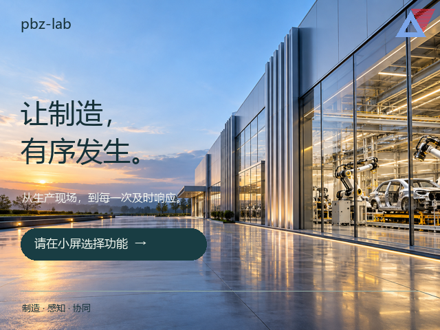
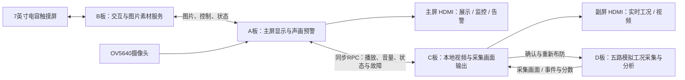
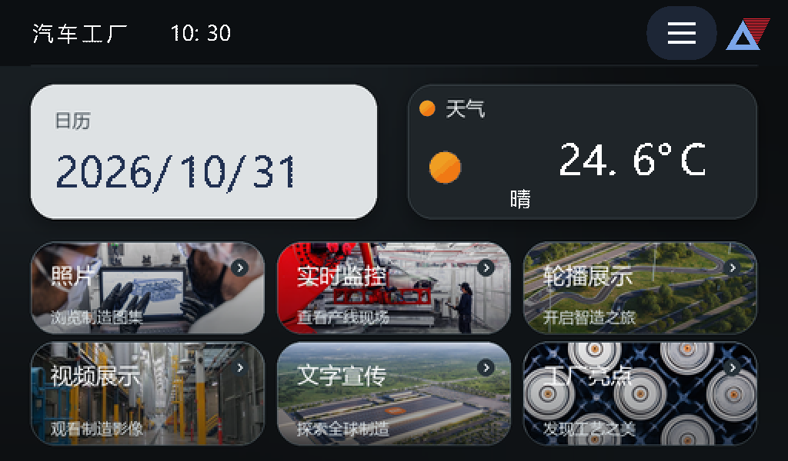
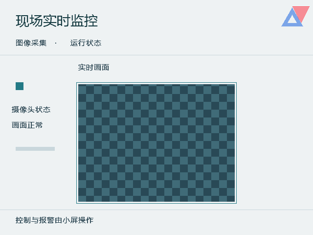
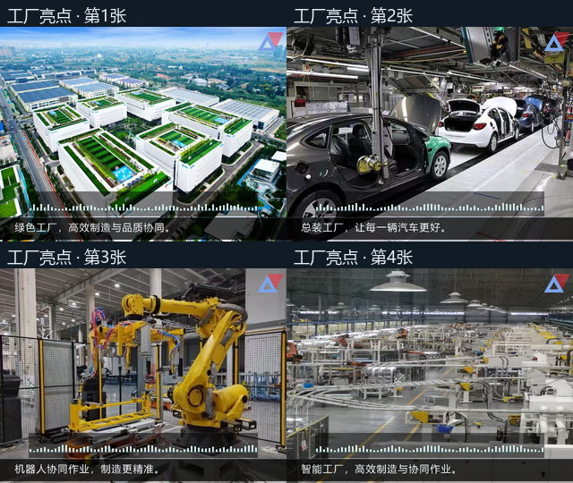
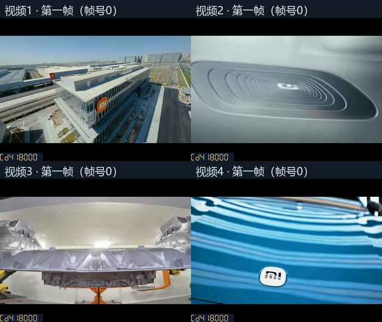
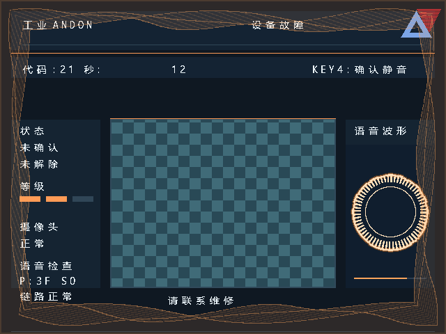

<div align="center">

# 智造 Andon 声画联动预警系统

**从生产展示，到每一次及时响应。**

基于安路 EG4S20 FPGA 的四板协同工业多媒体交互系统

`纯硬件架构` · `双屏协同` · `声画预警` · `五路工况分析` · `离线运行`



[作品介绍](#作品介绍) · [核心亮点](#核心亮点) · [界面与演示](docs/DEMO.md) · [快速运行](docs/QUICKSTART.md) · [硬件接线](docs/WIRING.md)

</div>

## 作品介绍

针对中小型制造现场看板功能单一、展示与预警割裂等问题，本作品基于安路 EG4S20 FPGA 设计“智造 Andon 声画联动预警系统”。系统通过纯硬件数据通路完成 TF 卡素材读取、图片与视频解析、SDRAM 帧缓存、触控交互及 HDMI 声画输出，将生产宣传、现场监控与分级预警融为一体。

正常运行时，制造主题图片、工厂亮点和宣传信息可通过触摸屏选择，也支持实体按键与自动轮播；“智造之旅”以书本翻页呈现制造流程。异常发生时，硬件优先级仲裁切换告警画面，结合中文语音、动态波形与摄像头预览，直观传递现场信息。五路模拟工况数据由独立采集板分析，经板间链路与显示端联动，构成“采集—分析—预警—确认”的完整演示闭环。

当前配套工程由作者完成实板验证，反馈运行稳定。本仓库提供加密 RTL 工程、配套位流、TF 素材、界面预览和复现文档，便于竞赛评审与作品展示。

## 核心亮点

| 亮点 | 实现与展示价值 |
|---|---|
| **纯硬件多媒体处理** | FPGA 完成读卡、解析、缓存、显示与控制，上电运行，常规声画演示无需上位机与网络参与 |
| **四板分工协同** | A 主屏预警、B 触屏交互、C 本地视频、D 采集分析，各板保有独立工作时钟与清晰接口 |
| **分级声画告警** | 缺料、设备故障、紧急停机三类告警，优先级抢占、中文语音、动态波形和现场预览协同呈现 |
| **高低分辨率统一展示** | 硬件双线性插值将每边不超过 2048 像素的受支持 BMP 适配至 640×480 显示画布 |
| **丰富的交互展示** | 四种图片切换效果、自动轮播、动态字幕，以及五视图书本翻页相册，兼顾操作效率与展示表现力 |
| **独立音视频通路** | C 本地解码四段视频并输出声画，支持片段自动轮播和本地按键，视频与采集画面按操作切换 |
| **统一声音控制** | B 控制中心统一调节 A 的宣传、工厂配乐、告警等声音及 C 的视频音量 |
| **工况分析与告警闭环** | 五路模拟数据、时域/频域/空间耦合分析、评分、冻结与八帧回看，并支持故障锁存与重新布防 |
| **细致的视觉反馈** | 抗锯齿中文字模、全宽滚动字幕、随 PCM 变化的波形，以及按真实处理状态推进的汽车主题加载动画 |

## 四板协同架构



| 板卡 | 主要职责 | TF 卡内容 |
|---|---|---|
| **A** | 主屏画面合成、摄像头预览、中文告警、音乐及音频可视化 | 告警语音、两组配乐及宣传文字 |
| **B** | 7 英寸触屏、页面与参数控制、BMP 读取和缩放、素材传输 | UI、照片、工厂亮点、宣传图、相册素材 |
| **C** | 本地视频解码、帧缓存、音视频同步与 D 数据转发 | 四个本地视频文件 |
| **D** | 五路模拟工况、时域/频域/耦合分析、评分与历史回看 | 当前采集联动无需 TF 卡 |

## 界面与演示

<table>
<tr><td align="center"><b>触屏首页</b></td><td align="center"><b>现场监控</b></td></tr>
<tr><td></td><td></td></tr>
<tr><td align="center"><b>制造主题与工厂亮点</b></td><td align="center"><b>四段视频第一帧</b></td></tr>
<tr><td></td><td></td></tr>
</table>



更多画面见 [媒体图集](docs/GALLERY.md)。图中画面由对应 RTL 模块与实际素材仿真生成，音频波形、字幕和诊断值表示选定时刻；实际运行时随声画和工况持续更新。

## 快速开始

1. 准备四块 EG4S20BG256 开发板、触摸屏、HDMI 显示设备、OV5640 摄像头和三张 FAT32 TF 卡。
2. 按 [接线说明](docs/WIRING.md) 连接 A/B、A/C、C/D，各板独立供电并共地。
3. 将 `media/TF_A`、`media/TF_B`、`media/TF_C` **各目录内的文件**复制到对应卡的根目录，D 无需 TF 卡。
4. 下载 `firmware/` 中与板卡对应的位流；建议先准备好 D、C、B，再复位 A 启动联动。
5. 从小屏选择照片、文字宣传、工厂亮点、智造之旅、实时监控或视频展示，按 [演示路线](docs/DEMO.md) 体验完整流程。

需要重新构建时，使用 TD **6.2.168116 / 6.2.1** 与 Python 3.9+，参见 [构建文档](docs/BUILD.md)。

## 工程目录

```text
.
├── boards/              # A/B/C/D 的 TD 工程入口
├── rtl/                 # 加密 HDL 与原位初始化数据
├── constraints/         # 各板引脚与时序约束
├── memory/              # 字体、图形和查找表的初始化数据
├── firmware/            # 配套实板位流
├── media/               # A/B/C 三张 TF 卡素材
├── scripts/             # 可迁移构建、完整性检查脚本
├── docs/                # 作品、演示、接线、构建与界面图集
├── verification/        # 加密清单、综合检查与基线时序报告
├── THIRD_PARTY_NOTICES.md
└── LICENSE
```

## 验证与发布

四板采用同一套配套工程协同工作。本次发布保留原有功能、引脚与时钟约束，仅对 HDL 的交付形式及仓库组织进行整理。原始明文工程独立保存，发布工程使用 TD 加密 HDL；加密文件包含安路编译密钥及相应仿真厂商密钥。

完整性与版本说明见 [验证记录](docs/VALIDATION.md)、[版本记录](CHANGELOG.md)。第三方 IP 与素材说明见 [版权与来源](THIRD_PARTY_NOTICES.md)。

## 项目定位

面向中小型制造现场的展示与预警需求，通过可独立演示的硬件系统，体现 FPGA 在并行声画处理、实时交互与多板协同中的应用价值。
